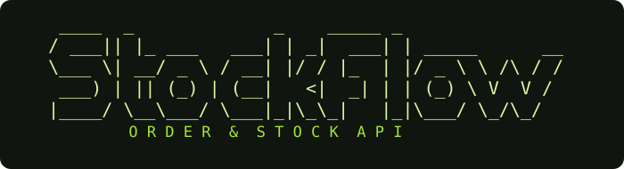

<div align="center">



API REST de gestión de pedidos y stock : UCAB


</div>

## Sobre el proyecto

Proyecto final de Desarrollo de APIs con Python, Universidad Católica Andrés Bello (UCAB). Backend para gestión de productos, pedidos y existencias con perfiles ADMIN y CUSTOMER, OAuth2/JWT, UUID y persistencia PostgreSQL. Arquitectura hexagonal, SDD y TDD. No incluye frontend.

Entrega: 16 de diciembre de 2026, 11:59 p. m. Equipo de 2 o 3 estudiantes; integrantes por confirmar en esta línea base documental.

## Organización

| Ruta | Propósito |
|---|---|
| app/ | Dominio, aplicación, puertos, adaptadores e infraestructura |
| tests/ | Pruebas unitarias, de integración y E2E |
| specs/ | Constitución, plantillas y especificaciones por módulo |
| docs/ | Arquitectura, requisitos, trazabilidad, workflow y auditoría |
| references/ | Identificación de fuentes académicas |
| assets/ | Identidad visual ASCII |
| AGENTS.md | Contrato para agentes |
| memory.md | Estado recuperable del proyecto |

## Desarrollo

Consultar [documentación](docs/README.md), [constitución](specs/constitution.md), [índice SDD](specs/README.md) y [flujo Git](docs/development/git-workflow.md). OpenCode implementará la API mediante FreeLLM API en el entorno local. ChatGPT prepara prompts y audita; el equipo humano aprueba decisiones y cambios.

```bash
git clone https://github.com/badjavii/stockflow-api.git
cd stockflow-api
git switch develop
```

Estado: inicialización documental. Aún no existe una API ejecutable, Dockerfile, Compose, requirements.txt ni suite funcional. La ejecución, configuración, autenticación, perfiles, bootstrap ADMIN y comandos de pruebas se documentarán en M01/M02 conforme se verifiquen. El archivo .env.example contiene nombres candidatos, no credenciales ni contrato definitivo.

## Colaboración

Las ramas nacen de develop; las PR de trabajo apuntan a develop. main se reserva para entregas estables. El [registro de ramas](docs/project/branch-ledger.csv) y el [registro de prompts](docs/PROMPTS.md) conservan evidencia. Los prompts no contienen secretos. Las pruebas planificadas no se presentan como ejecutadas.

Metodología adaptada de [RutasVenezuela](https://github.com/badjavii/rutasvenezuela/tree/develop), sin reutilizar su arquitectura de datos.

## Licencia

Consultar [LICENSE](LICENSE).
