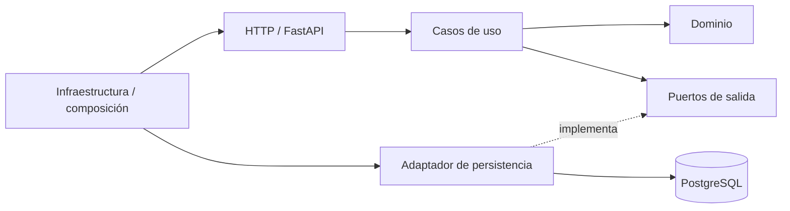

# Arquitectura propuesta

FastAPI es adaptador de entrada HTTP; PostgreSQL es tecnología de persistencia externa al núcleo. La organización inicial es por capas hexagonales.

Dominio: entidades, valores, invariantes. Aplicación: casos de uso, identidad/propiedad, coordinación de transacciones y puertos. Adaptadores: validación HTTP, códigos de estado, serialización, repositorios y servicios tecnológicos. Infraestructura: configuración y composición de dependencias.

Reglas: dependencias del núcleo hacia contratos internos, no hacia adaptadores. Las restricciones DB protegen integridad; la confirmación de pedido y descuento se ejecutan como unidad atómica, con concurrencia segura. Validar propiedad en casos de uso, no solo rutas. Usar representaciones monetarias exactas.

Pendiente de PLAN M01/M02: versión Python, ORM/driver, migraciones, sincronía/asincronía, unidad de trabajo, hash, JWT, nomenclatura de configuración y estrategia de pruebas. M04/M05 decidirán estados, precios históricos y política de elementos repetidos sin ampliar el alcance.
